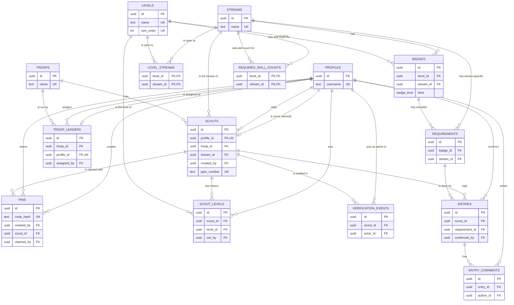

# Data model

Tables, columns and relationships for the MVP. Built from [mvp-spec.md](mvp-spec.md) and
[permission-matrix.md](permission-matrix.md). Database: PostgreSQL on Supabase. Every table gets RLS in the
same migration that creates it (R4).

Conventions: `id` is a `uuid` primary key. `created_at` is `timestamptz` with default `now()`. Names are
`snake_case`.

## ERD

Shows keys and relationships. Every column is listed in [Tables](#tables).

## Tables

### profiles

One row per login. Holds the role, so the role check is one lookup.

| Column | Type | Notes |
| --- | --- | --- |
| id | uuid, PK | Same value as `auth.users.id` |
| role | `role` enum | `admin`, `leader` or `scout` (R5) |
| username | text, unique, nullable | Set when the account is created or updated. Admins, Leaders and Scouts can change it |
| full_name | text, nullable | Admins and Leaders only. Scouts' names live on `scouts` |
| created_at | timestamptz | |

### pins

PINs for claiming accounts. Leader PINs come from the Admin. Scout PINs come from a Leader and are tied to a Scout.

| Column | Type | Notes |
| --- | --- | --- |
| id | uuid, PK | |
| kind | `pin_kind` enum | `leader` or `scout` |
| code_hash | text, unique | Store a hash, never the PIN itself |
| created_by | uuid, FK to profiles | The Admin or the Leader who made it |
| scout_id | uuid, FK to scouts, nullable | Only for scout PINs |
| claimed_by | uuid, FK to profiles, nullable | Null until used |
| claimed_at | timestamptz, nullable | |
| created_at | timestamptz | |

### troops

| Column | Type | Notes |
| --- | --- | --- |
| id | uuid, PK | |
| name | text, unique | |
| leaders_required | int | Set by the Admin; must be 1 or more |
| created_at | timestamptz | |

### troop_leaders

Which Leader runs which troop. A Leader has one troop, so `profile_id` is unique. A troop can have several Leaders.

| Column | Type | Notes |
| --- | --- | --- |
| id | uuid, PK | |
| troop_id | uuid, FK to troops | |
| profile_id | uuid, FK to profiles, unique | |
| assigned_by | uuid, FK to profiles | The Admin |
| assigned_at | timestamptz | |

### scouts

A Scout exists as soon as a Leader adds them. `profile_id` stays null until the Scout claims the PIN.

| Column | Type | Notes |
| --- | --- | --- |
| id | uuid, PK | |
| profile_id | uuid, FK to profiles, unique, nullable | Null until claimed |
| troop_id | uuid, FK to troops | |
| stream_id | uuid, FK to streams | Set by the Leader when the Scout is added. Must be open at the Scout's level |
| full_name | text | Entered by the Leader, who can correct it. Scouts cannot change it |
| ppm_number | text, unique, nullable | PPM membership number. Optional when the Leader adds the Scout. Must be set before the Admin can verify them |
| is_active | bool, default true | Deactivated Scouts cannot log in |
| is_verified | bool, default false | Current state; history is in `verification_events` |
| created_by | uuid, FK to profiles | The Leader who added them |
| created_at | timestamptz | |

The current level is not stored on `scouts`. It is the `scout_levels` row with `ended_at` null. Read it with a
query or view, so it cannot drift from the level history.

### levels

| Column | Type | Notes |
| --- | --- | --- |
| id | uuid, PK | |
| name | text, unique | |
| sort_order | int, unique | Order of the level journey |
| top_award | text | Highest award for this level |

Seeded with the five PPM sections, in this order (see [mvp-spec.md](mvp-spec.md#levels)):

| sort_order | name | top_award |
| --- | --- | --- |
| 1 | Pengakap Lebah | Lencana Lebah |
| 2 | Pengakap Kanak-Kanak | Anugerah Rambu Pengakap Kanak-Kanak |
| 3 | Pengakap Muda | Anugerah Rambu Pengakap Muda |
| 4 | Pengakap Remaja | Anugerah Pengakap Raja (King's Scout) |
| 5 | Pengakap Kelana | Anugerah BP Award (Baden-Powell Award) |

### streams

The four PPM streams. Seeded and fixed in the MVP.

| Column | Type | Notes |
| --- | --- | --- |
| id | uuid, PK | |
| name | text, unique | Seeded: Pengakap, Pengakap Laut, Pengakap Udara, Pengakap Khas |

### level_streams

Which streams are open at each level. Seeded from the matrix in [mvp-spec.md](mvp-spec.md#streams). Fixed in the MVP.

| Column | Type | Notes |
| --- | --- | --- |
| level_id | uuid, PK, FK to levels | |
| stream_id | uuid, PK, FK to streams | |

Composite primary key on `(level_id, stream_id)`.

### scout_levels

Level history. Each row is one stay at one level. The row with `ended_at` null is the current level.
Starting level, promotions and Raja eligibility all come from this table.

| Column | Type | Notes |
| --- | --- | --- |
| id | uuid, PK | |
| scout_id | uuid, FK to scouts | |
| level_id | uuid, FK to levels | |
| started_at | timestamptz | |
| ended_at | timestamptz, nullable | Null = current level |
| set_by | uuid, FK to profiles | The Leader who set the starting level or promoted |

Partial unique index on `(scout_id) where ended_at is null`, so a Scout has only one current level.

### badges

| Column | Type | Notes |
| --- | --- | --- |
| id | uuid, PK | |
| level_id | uuid, FK to levels | |
| stream_id | uuid, FK to streams, nullable | Null = general badge, for every stream. Set = stream-specific badge |
| name | text | |
| description | text | |
| sort_order | int | |
| kind | `badge_kind` enum | `compulsory` or `skill`. Decides how progress is counted (see Decisions) |
| deleted_at | timestamptz, nullable | Soft delete, so old entries keep their badge |

### required_skill_counts

How many skill badges a Scout must complete for a level and stream. Set by the Admin.

| Column | Type | Notes |
| --- | --- | --- |
| level_id | uuid, PK, FK to levels | |
| stream_id | uuid, PK, FK to streams | |
| required_count | int | 0 or more. Must not exceed the number of skill badges for that level and stream. The Admin API rejects a higher value |

Composite primary key on `(level_id, stream_id)`.

### requirements

The checklist for a badge.

| Column | Type | Notes |
| --- | --- | --- |
| id | uuid, PK | |
| badge_id | uuid, FK to badges | |
| stream_id | uuid, FK to streams, nullable | Null = general requirement, for every stream. Set = stream-specific |
| position | int | Unique per badge |
| text | text | |

### entries

A Scout marking one requirement as done.

| Column | Type | Notes |
| --- | --- | --- |
| id | uuid, PK | |
| scout_id | uuid, FK to scouts | |
| requirement_id | uuid, FK to requirements | |
| entry_date | date | When the Scout did it |
| note | text, nullable | |
| status | `entry_status` enum | `pending` or `confirmed` |
| confirmed_by | uuid, FK to profiles, nullable | The Leader |
| confirmed_at | timestamptz, nullable | |
| created_at | timestamptz | |
| updated_at | timestamptz | |

Unique on `(scout_id, requirement_id)`.

### entry_comments

SHOULD story: a Leader asks for more detail without rejecting the entry.

| Column | Type | Notes |
| --- | --- | --- |
| id | uuid, PK | |
| entry_id | uuid, FK to entries | |
| author_id | uuid, FK to profiles | |
| body | text | |
| created_at | timestamptz | |

### verification_events

Audit log. `scouts.is_verified` is the current state. This table answers who changed it and when.

| Column | Type | Notes |
| --- | --- | --- |
| id | uuid, PK | |
| scout_id | uuid, FK to scouts | |
| action | `verification_action` enum | `verify` or `unverify` |
| actor_id | uuid, FK to profiles | The Admin |
| created_at | timestamptz | |

## Enums

Defined once in `backend/app/enums.py` and mirrored in `frontend/src/enums.ts` (R5).

| Enum | Values |
| --- | --- |
| `role` | `admin`, `leader`, `scout` |
| `pin_kind` | `leader`, `scout` |
| `entry_status` | `pending`, `confirmed` |
| `verification_action` | `verify`, `unverify` |
| `badge_kind` | `compulsory`, `skill` |

Badge status (`not_started`, `in_progress`, `complete`) is not stored. It is computed from entries (see Decisions).

## Decisions

- **Badge status is computed, not stored.** `not_started` = no entries. `in_progress` = some entries.
  `complete` = every general and stream-specific requirement in the Scout's checklist has a confirmed entry. A badge
  only counts as unlocked when the Scout is verified.
- **One entry per requirement per Scout.** A requirement is done once. Editing an entry changes it.
- **Editing a confirmed entry sets it back to `pending`.** So the Leader sees the change.
- **Badges are soft-deleted.** Deleting a badge sets `deleted_at`, so entries keep their history.
- **Deactivating a Scout sets `is_active = false` and keeps `troop_id`.** A deactivated Scout cannot log in
  and no longer appears as active. The troop is kept so their history stays linked.
- **PINs are stored as hashes.** A PIN is shown once. If it is lost, make a new one.
- **Raja eligibility is a query.** Look for a `scout_levels` row for Pengakap Muda and a row for Pengakap Remaja
  whose `started_at` is later than Muda's. No flag is stored.
- **A Scout has one stream.** The Leader sets it when adding the Scout. The starting level, and every promotion
  after it, must be open to that stream (`level_streams`). The stream cannot change in the MVP.
- **A Scout's current level is derived.** It comes from `scout_levels` where `ended_at` is null, and is shown
  alongside the stream in the Scout's progress, the Leader's troop list, the Admin's unverified list and the printout.
- **Badges belong to one level. They are general or stream-specific.** A general badge has a null `stream_id` and
  applies to every stream. A stream-specific badge sets `stream_id`.
- **Raja needs one stream.** Muda and Remaja must be in the same stream, and Remaja follows Muda. The stream is read
  from `scouts.stream_id`, so this holds while stream changes are off in the MVP.
- **A Scout's checklist is general plus stream-specific.** For a badge, it is every requirement where `stream_id`
  is null or equals the Scout's stream.
- **Each level has its own top award.** Progress is shown toward the current level's `top_award`. The Raja
  prerequisites (Muda, then Remaja) apply only to Anugerah Pengakap Raja.
- **Admins read verification data only.** RLS on `entries` and `entry_comments` blocks Admins (permission matrix).
- **Leaders edit Scout names in their troop.** RLS on `scouts` lets a troop's Leader update `full_name`. Scouts cannot.
- **Passwords live in Supabase Auth.** These tables never store them.
- **Progress % is toward the current level's top award.** Counted per Scout, for their stream:
  - Compulsory badges = badges with `kind` `compulsory` in the Scout's current level, for their stream.
  - Skill badges required = `required_skill_counts.required_count` for that level and stream, capped at the number
    of skill badges that exist for that level and stream.
  - `progress = (completed compulsory + min(completed skill, required)) / (total compulsory + required)`, where
    `required` is the capped value. Progress can always reach 100%.
  - If the denominator is 0 (no compulsory badges and a required count of 0), progress is 0%.
  - "Completed" means badge status `complete` (see above). Extra skill badges above the required count do not
    raise progress.
- **Notification threshold is 70%, a placeholder.** The stories say 70%. Keep it as one constant so it can
  change once the team picks the moment to notify.
- **Notifications are in-app and computed on read.** No notifications table. When a Leader or Scout loads the
  app and progress is at or above the threshold, the app shows the alert. Nothing is stored, so there is no
  read/unread state, and the alert shows again on each visit while the threshold is met. Email is deferred.
- **Scouts' personal data is limited to full name and PPM membership number** (`ppm_number`). The app does not
  store birth date, IC number or contact details for Scouts, because Scouts are minors and PDPA asks for only
  the data the app needs. The level already shows an age band, which is accepted. `ppm_number` is unique. The
  Leader may leave it blank when adding a Scout; the Admin cannot verify the Scout until it is set.
- **General badges have a null `badges.stream_id`.** A general badge is the same for every stream, with one name
  and one checklist, so it is stored once. A stream-specific badge sets `stream_id`. The Admin edits a general
  badge once and every stream sees the change. Per-stream versions of a general badge are not supported in the
  MVP. To find a Scout's badges, the app takes rows where `stream_id` is null or equals the Scout's stream, the
  same rule as requirements.
- **`badge_kind` is an enum on `badges`.** Adding it follows R5: define it in `backend/app/enums.py`, mirror it in
  `frontend/src/enums.ts`, and add the migration in the same PR.

## Open questions

The notification threshold is still a placeholder (70%). It stays one constant until the team picks the moment to notify.
The scope (Pengakap Laut path only for the MVP deployment) is recorded in [mvp-spec.md](mvp-spec.md).
The badge `complete` rule is decided above and will be implemented in #15.
